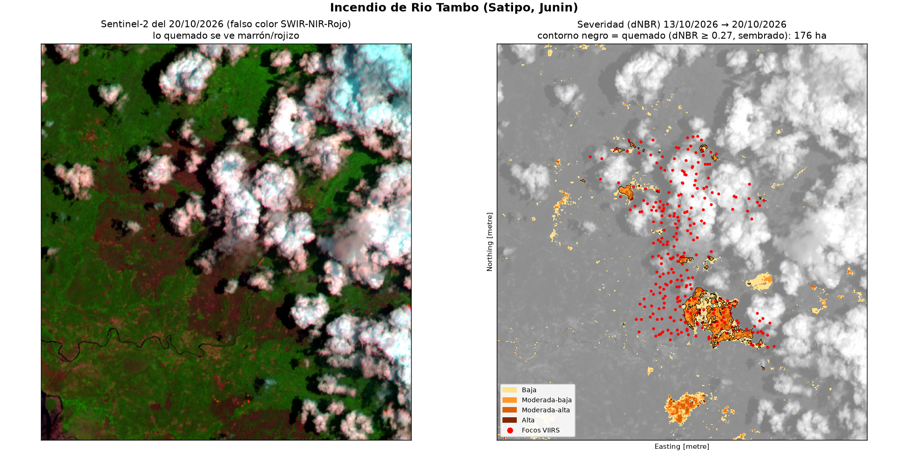
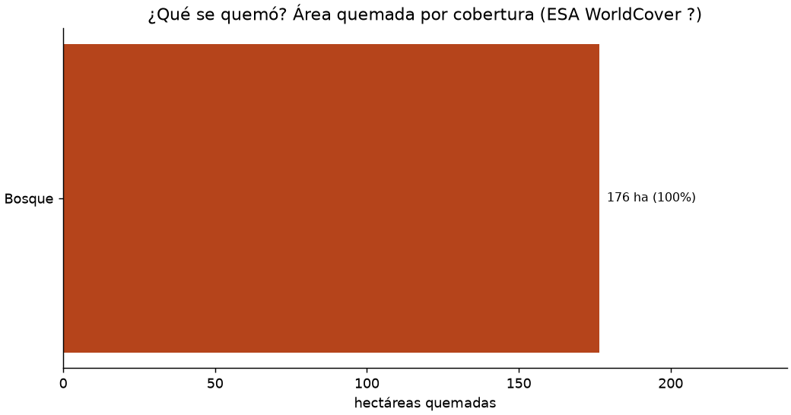

# Incendios en el Perú vistos desde el espacio: Rio Tambo

**Retos A + C** · Ciencia de datos con Python · corte de datos: 21/10/2026 21:02

Presentación: abre [`docs/index.html`](docs/index.html) (o el sitio de GitHub Pages si está activado) · Mapa interactivo: [`docs/mapa.html`](docs/mapa.html)

## La pregunta

¿Cuántas hectáreas quemó el incendio de **Rio Tambo (Satipo, Junin)** y **qué tipo de cobertura** se perdió: bosque, pastizal o cultivo?

## Tres hallazgos con números

1. El incendio de Rio Tambo (Satipo, Junin) quemó unas 176 ha entre el 13/10/2026 y el 20/10/2026 (dNBR ≥ 0.27, parches conectados a 279 focos VIIRS). Solo con el umbral, sin exigir focos cerca, saldrían 257 ha: la decisión de método cambia el número.
2. Lo que se quemó fue sobre todo 100% bosque (WorldCover ?).
3. 32% del área quemada tiene severidad moderada-alta o alta (57 ha). En el Perú hubo 8 613 focos VIIRS del 14/10/2026 al 21/10/2026, agrupados en 754 incendios (451 con huella > 100 ha); este es el #1 por número de focos.


## Mapa





| Severidad (dNBR, USGS) | ha |
|---|---:|
| Baja | 84 |
| Moderada-baja | 120 |
| Moderada-alta | 55 |
| Alta | 2 |

| Distrito | Provincia | ha quemadas |
|---|---|---:|
| Rio Tambo | Satipo | 176 |

| Cobertura (WorldCover ?) | ha | % |
|---|---:|---:|
| Bosque | 176 | 100.0% |

## Datos y fechas

| Dato | Fuente | Tipo | Fechas usadas |
|---|---|---|---|
| Focos de calor | NASA FIRMS, VIIRS S-NPP / NOAA-20 / NOAA-21, «South America 7d» | Puntos (CSV) | 14/10/2026 – 21/10/2026 |
| Imágenes | Sentinel-2 L2A, Microsoft Planetary Computer (`sentinel-2-l2a`) | Raster 10–20 m | antes 13/10/2026 (16.4% nubes) · después 20/10/2026 (53.1% nubes) |
| Cobertura del suelo | ESA WorldCover (`esa-worldcover`) | Raster 10 m | ? |
| Límites distritales | INEI vía GitHub `juaneladio/peru-geojson` | Polígonos | — |

## Método

1. **Focos:** descargo los focos VIIRS de 7 días, me quedo con los que caen en distritos del Perú y descarto los de confianza baja (8 613 focos).
2. **Incendios:** focos a ≤ 1 km y ≤ 48 h entre sí forman un mismo incendio; descarto grupos de menos de 3 focos (posibles fuentes fijas). Resultan 754 incendios. Elegí el #1 por número de focos: 279 focos del 14/10/2026 al 17/10/2026.
3. **Zona:** 3 km alrededor de los focos, en UTM (EPSG:327xx) a 20 m por píxel. Las áreas no se calculan en grados (EPSG:4326).
4. **Imágenes:** reviso 15 fechas de Sentinel-2 y mido las nubes **en la zona del incendio** (capa SCL), no en toda la escena. Elijo la imagen más reciente antes del primer foco con ≤ 20% nubes y la más reciente después con ≤ 30%. La tabla completa está en `outputs/escenas_sentinel2.csv`.
5. **dNBR:** NBR = (B08 − B12)/(B08 + B12); dNBR = NBR antes − NBR después. Enmascaro nubes, sombras y agua con SCL en ambas fechas (queda válido el 41% de la zona).
6. **Área quemada:** dNBR ≥ 0.27, contando solo los parches conectados a ≤ 750 m de un foco VIIRS. Sin ese filtro salen 257 ha en lugar de 176 ha.
7. **Por distrito:** `rasterstats.zonal_stats` sobre el raster de quemado, con los distritos reproyectados al mismo CRS.
8. **¿Qué se quemó?:** cruzo los píxeles quemados con WorldCover (vecino más cercano a 20 m).

## Limitaciones

- **Un foco de calor no es un incendio.** VIIRS detecta píxeles calientes de 375 m, que también pueden ser quemas agrícolas.
- **Las nubes y el humo esconden el fuego.** Los píxeles nublados en cualquiera de las dos fechas no se cuentan, así que el área puede estar **subestimada**.
- **El incendio puede seguir activo.** Lo que ardió después del 20/10/2026 no está incluido.
- **El umbral de 0,27 es una convención del USGS.** En pastizales de altura la señal es más débil y hay quemas que no lo superan.
- WorldCover es de ?, así que la cobertura pudo cambiar desde entonces.
- Es una herramienta académica y no reemplaza los reportes del COEN, INDECI, SERFOR ni SERNANP.

## Cómo reproducirlo

```bash
python -m venv .venv
.venv\Scripts\activate          # Windows  (Mac/Linux: source .venv/bin/activate)
pip install -r requirements.txt
python pipeline.py               # ~5-15 min según la conexión
```

Para analizar otro incendio, cambia `DISTRITO_OBJETIVO` al inicio de `pipeline.py` (p. ej. `"RIO TAMBO"`). La lista de incendios activos está en `outputs/incendios_7dias.csv`.

## Estructura

```
pipeline.py        # todo el análisis (pasos 1-8)
presentacion.py    # genera docs/index.html y este README desde outputs/resultados.json
outputs/           # tablas CSV, dnbr.tif, quemado.tif, resultados.json
docs/              # presentación HTML, mapa interactivo e imágenes
```
